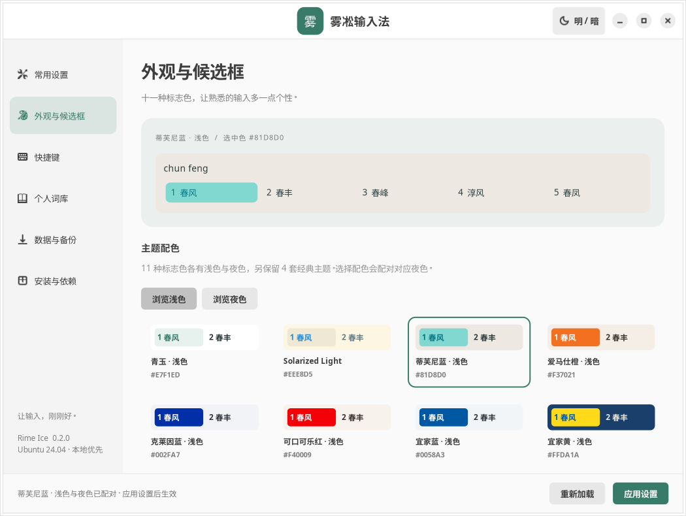

# Rime Ice · 雾凇输入法设置

面向 **Ubuntu 24.04 amd64** 的原生输入法设置中心，基于 Fcitx5、Rime 和公开雾凇拼音，提供标准 `.deb` 安装包；系统依赖由 Ubuntu 软件源安装。

这是独立开发的设置工具，并非 Fcitx5、Rime 或雾凇拼音的官方发行版。当前版本为 **0.2.0 预览版**。



## 功能

- 原生 GTK4 / libadwaita 设置界面，支持窗口明暗切换。
- 新增 11 种品牌配色，每种提供浅色与夜色版本；保留青玉、墨夜和 Solarized，共 26 套候选框主题。
- 字体、字号、横纵向排列、每页 3–9 个候选，以及跟随系统明暗。
- 输入法切换快捷键预设、左 Shift 行为、中文与英文词库学习开关。
- 个人短语增删改查、TXT 导入预览与去重、导出、固定第二候选。
- 保存前自动备份、个人配置导出与恢复、并发修改检测。

## 新增配色

每种配色都有浅色和夜色版本。选择浅色主题会自动配对对应夜色主题；也可单独选择夜色主题。HEX 值用于候选项高亮背景。

| 配色 | RGB |
| --- | --- |
| 蒂芙尼蓝 | `#81D8D0` |
| 爱马仕橙 | `#F37021` |
| 克莱因蓝 | `#002FA7` |
| 可口可乐红 | `#F40009` |
| 宜家蓝 | `#0058A3` |
| 宜家黄 | `#FFDA1A` |
| 经典蓝 | `#0F4C81` |
| 长春花蓝 | `#6667AB` |
| 皇家蓝 | `#4169E1` |
| 酸橙绿 | `#DFFF00` |
| 千禧粉 | `#F3C6C8` |

## 安装

前往 [0.2.0 发布页面](https://github.com/zhou411X/rime-ice/releases/tag/v0.2.0) 下载下列安装包。仓库现名为 `zhou411X/rime-ice`。

新版包与主命令为 `rime-ice`。应用包包含设置中心、雾凇拼音方案、公开词典和主题，不捆绑 Fcitx5、Rime 引擎、GTK 或字体等系统依赖。

### 首次安装

下载 `rime-ice_0.2.0_all.deb`，在下载目录执行：

```bash
sudo apt install ./rime-ice_0.2.0_all.deb
```

APT 会检查依赖，并从 Ubuntu 软件源安装缺少的部分；目标电脑需要可用的软件源和网络。安装完成后，拼音输入、词典、主题和个人配置均可离线使用。

若使用 `dpkg -i` 安装后提示依赖缺失，可联网执行 `sudo apt --fix-broken install`，检查 APT 给出的安装计划后确认。推荐直接使用上面的 `apt install` 命令。

### 从 0.1.0 升级

同时下载主包和过渡包，在下载目录执行：

```bash
sudo apt install ./rime-ice_0.2.0_all.deb ./rime-ice-settings_0.2.0_all.deb
```

旧命令 `rime-ice-settings` 仍可启动，升级保留用户配置和个人词库。

安装后从应用菜单打开“雾凇拼音”，或执行 `rime-ice`。在“常用设置”中启用，按提示在 Fcitx5 配置工具中添加 Rime，然后注销并重新登录。

### 发行文件与校验

| 文件 | 用途 |
| --- | --- |
| `rime-ice_0.2.0_all.deb` | 应用安装包，系统依赖由 APT 安装 |
| `rime-ice-settings_0.2.0_all.deb` | 旧包名的空过渡包，用于升级 |
| `*_source.tar.gz` | 构建应用所用的代码、公开数据、主题和打包脚本 |
| `SHA256SUMS-0.2.0` | 发行附件的 SHA256 校验清单 |
| `DELIVERY-0.2.0.txt`、`VALIDATION-0.2.0.txt` | 安装说明和验证范围 |

在附件所在目录执行 `sha256sum -c SHA256SUMS-0.2.0 --ignore-missing`，校验已下载文件。

## 范围与限制

- 首版支持 Ubuntu 24.04 amd64；尚未验证 ARM64 或其他 Ubuntu 版本。
- 已验证隔离 Ubuntu 环境中的安装与升级；实体 GNOME/Wayland 桌面的端到端输入体验仍需验证。
- 候选框主题面向 Fcitx5 Classic UI；GNOME/KDE 扩展接管候选框时，外观可能由扩展控制。
- 设置页管理雾凇全拼；其他方案通过 Fcitx5 配置工具或 Rime 选单管理。
- 个人词库页管理自定义短语。Rime 学习数据库通过 Rime 自身同步功能迁移，不直接编辑或随配置备份复制。
- 更新应用不会自动覆盖用户已有词典。修改 YAML 会保留未管理字段，但注释格式可能重排；原文件保存在自动备份中。
- 本版不发布完整离线依赖包。缺少系统依赖时需要联网安装；已有依赖时可直接安装应用包。

## 数据与隐私

所有设置和个人短语保存在本机。仓库及发行包只包含公开上游数据、自制及适配主题和默认配置，不包含开发者个人短语、学习数据库、同步记录或安装标识。

| 内容 | 默认位置 |
| --- | --- |
| Fcitx5 配置 | `~/.config/fcitx5` |
| Rime 用户数据 | `~/.local/share/fcitx5/rime` |
| 自动备份 | `~/.local/state/rime-ice/backups` |
| 安装的公共数据 | `/usr/share/rime-ice/rime` |

遵循对应 XDG 环境变量。卸载应用不会自动删除用户配置和词库。

## 从源码构建

仓库已包含构建所需的公开词典与主题快照，普通构建无需运行 `prepare_data.py`。

在具有 Python 3、`dpkg-deb` 和标准 GNU 工具的 Ubuntu 24.04 构建机执行：

```bash
./build_deb.sh
./build_source.sh
```

产物写入 `dist/`，包括主包、空过渡包和对应应用源码；这两个命令无需联网收集 Ubuntu 依赖。详细说明见 [packaging/README.txt](packaging/README.txt)。

`python3 prepare_themes.py` 仅重新生成主题，不改词典。`build_offline.sh` 和 `build_sources.sh` 保留为按需自行构建离线依赖包及对应源码的工具，不属于本版默认发布流程。

`prepare_data.py` 用于重新生成公开快照：它读取 `/tmp/rime-ice-public-source.tar.gz`，上游 commit 与归档校验值见 [UPSTREAM.json](UPSTREAM.json)。重建数据前应核对来源与校验值；正常打包直接使用仓库中的 `data/`。

## 验证

开发依赖包括 Python GI、PyYAML、GTK4/libadwaita、Xvfb、D-Bus，以及 Fcitx5/Rime；具体运行依赖见 [packaging/control](packaging/control)。

```bash
/usr/bin/python3 -m unittest discover -s tests -v
PYTHONPATH=. GTK_A11Y=none ADW_DISABLE_PORTAL=1 GDK_BACKEND=x11 \
  GSK_RENDERER=cairo xvfb-run -a dbus-run-session \
  --config-file=tests/session.conf -- /usr/bin/python3 tests/check_gui.py
```

0.2.0 已通过 24 项单元测试（0 失败）、六页面原生界面检查和 11 组日夜配对与预览检查。最新标准 `.deb` 在 Ubuntu Base 24.04.4 + PRoot 5.5 中通过 APT 新装和从 0.1.0 升级验证：依赖由独立的测试软件源提供，安装包内不捆绑系统软件；安装后 dpkg 审计为空，个人配置与词条保持原样。此前真实 Fcitx5 主题读取及 Rime 部署/恢复检查也已通过。测试使用临时用户目录，未覆盖实体 GNOME/Wayland 桌面输入体验。

标准发行包只提供应用 `.deb`、升级过渡包及 `rime-ice_0.2.0_source.tar.gz`；不上传 Ubuntu 依赖包和依赖源码。校验清单为 `SHA256SUMS-0.2.0`，验证详情见发行附件 `VALIDATION-0.2.0.txt`。

## 来源与许可

- 设置中心、配置扩展与自制主题：GPL-3.0-only，见 [LICENSE](LICENSE)。
- 公开词典与相关 Lua 数据来自 [iDvel/rime-ice](https://github.com/iDvel/rime-ice)，固定版本及归档哈希见 [UPSTREAM.json](UPSTREAM.json)，保留原始许可证与文件版权声明。
- 新增配色参考 [nevertoday/rime-color-scheme](https://github.com/nevertoday/rime-color-scheme)，将原 BGR 颜色适配为 Fcitx5 RGB，保留指定高亮色及浅色/夜色搭配；固定版本见 [THEME_UPSTREAM.json](THEME_UPSTREAM.json)，MIT 许可见 [LICENSES/rime-color-scheme.txt](LICENSES/rime-color-scheme.txt)。配色名称仅作识别，不代表品牌授权或合作。
- `data/rime/lua/lunar.db` 是公开上游的历法数据，不是个人学习数据库。
- Fcitx5、Rime 和 Ubuntu 依赖由系统软件源提供，保留各自许可证；本应用不重新打包分发这些系统软件。
